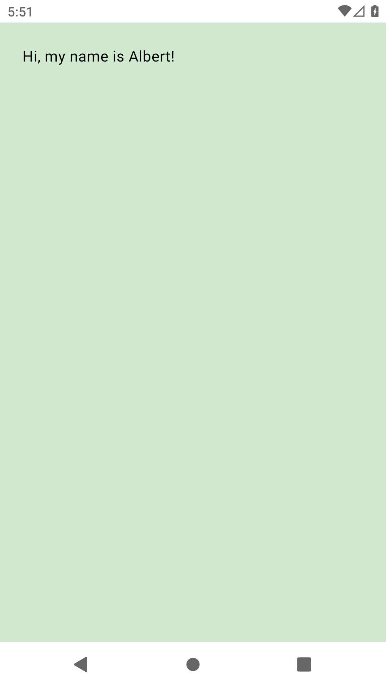
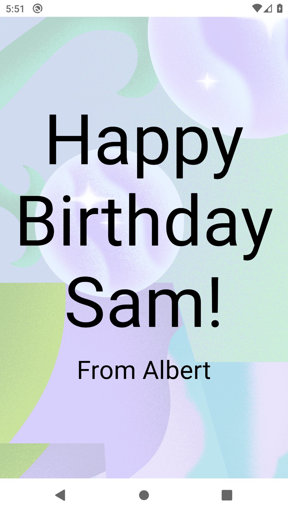
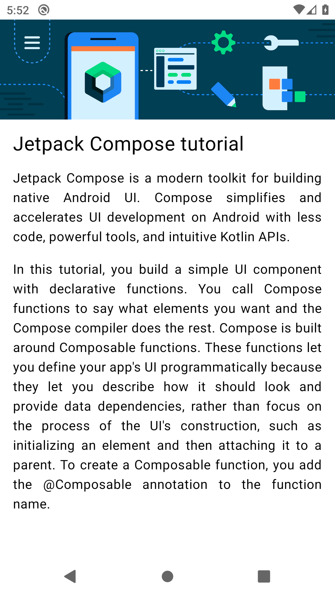
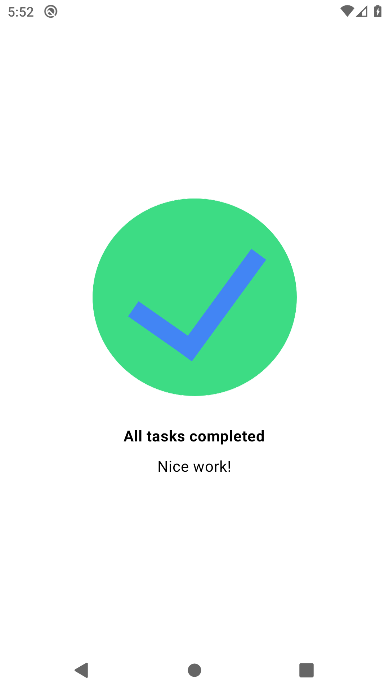
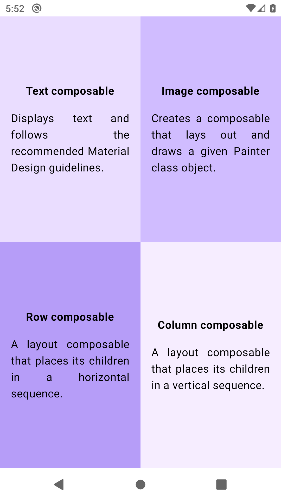
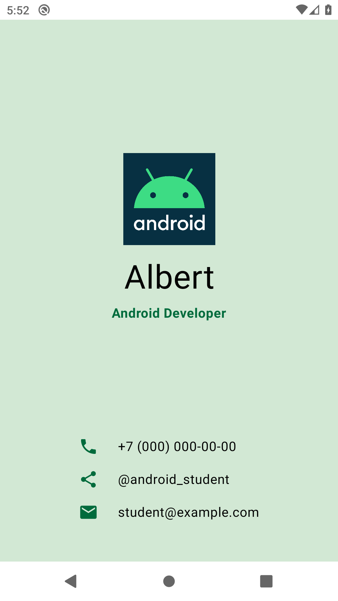

# Скриншоты работающих приложений

Получены из Android-эмулятора API 29 (Pixel 2, 1080×1920) в
[успешном запуске GitHub Actions](https://github.com/Aadalberht/android-basics-compose-labs/actions/runs/39296610114).
Это реальные захваты экранов после установки и запуска APK.
Рядом с PNG сохранены XML-деревья интерфейса из UI Automator.

| Приложение | Экран |
|---|---|
| Greeting |  |
| Happy Birthday |  |
| Compose Article |  |
| Task Manager |  |
| Compose Quadrant |  |
| Business Card |  |
