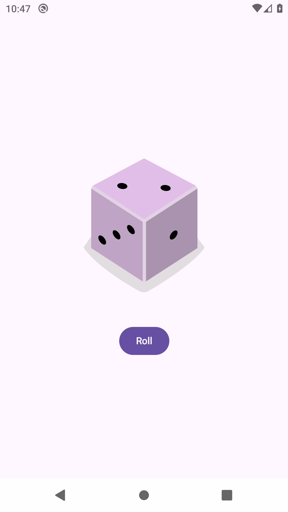
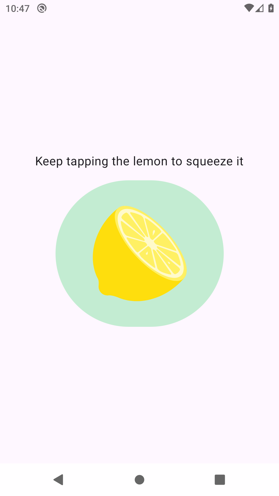
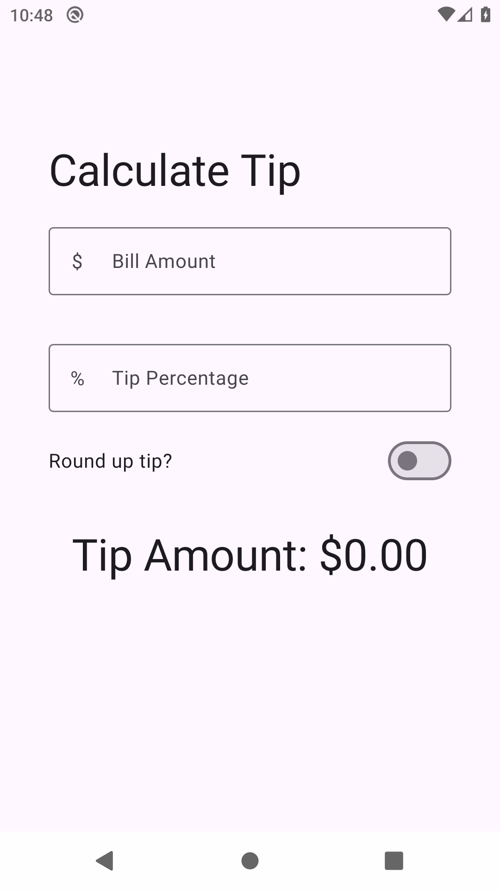
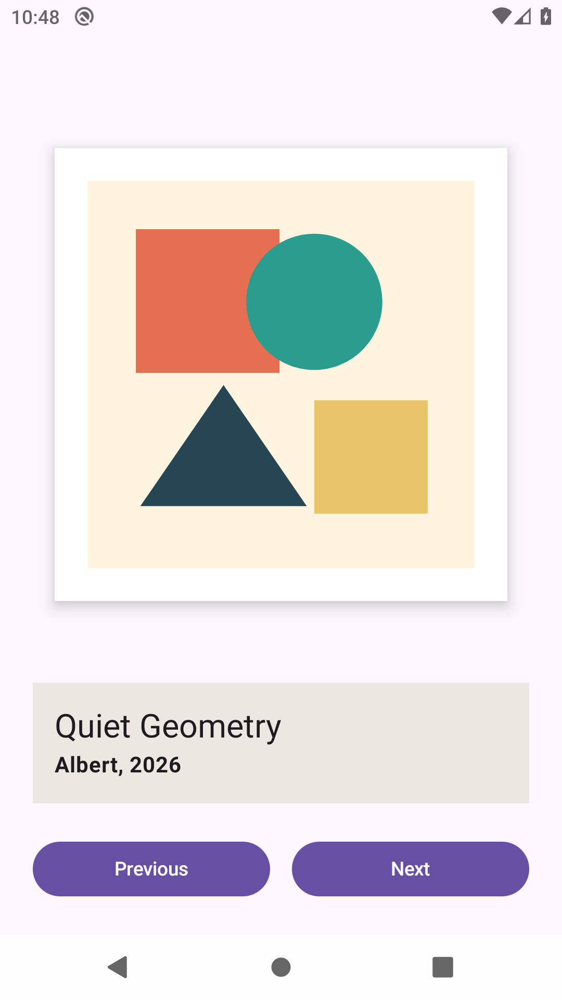

# Скриншоты работающих приложений Unit 2

Получены из Android-эмулятора API 29 (Pixel 2, 1080×1920) в
[успешном запуске GitHub Actions](https://github.com/Aadalberht/android-basics-compose-labs/actions/runs/41621286772).
Это реальные захваты экранов после установки, запуска и автоматизированных
нажатий. Рядом с PNG сохранены XML-деревья интерфейса из UI Automator.

| Приложение | Экран |
|---|---|
| Dice Roller после нажатия Roll |  |
| Lemonade на этапе выжимания лимона |  |
| Tip Time |  |
| Art Space после нажатия Next |  |
